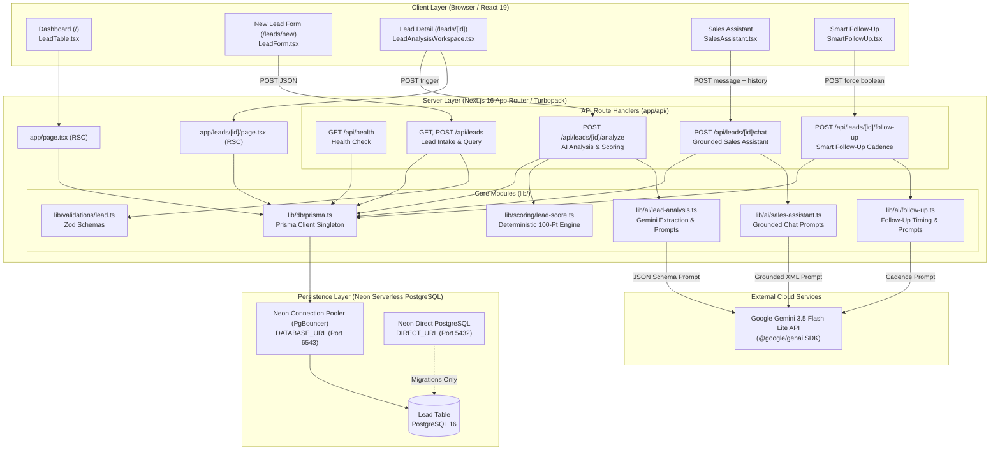
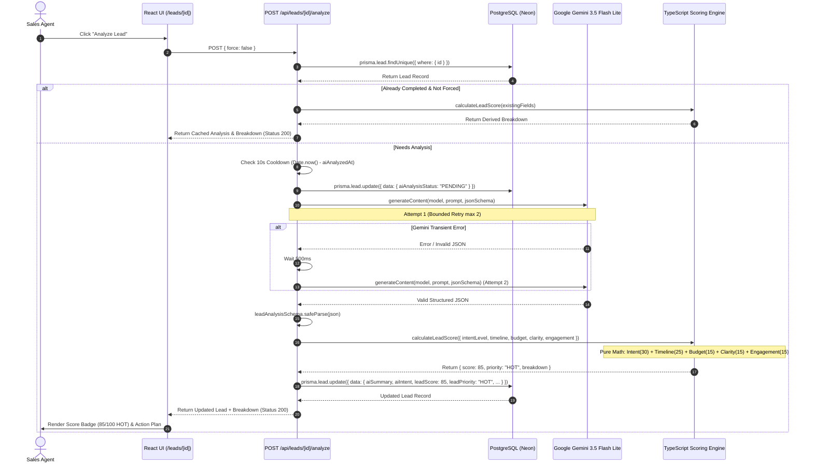
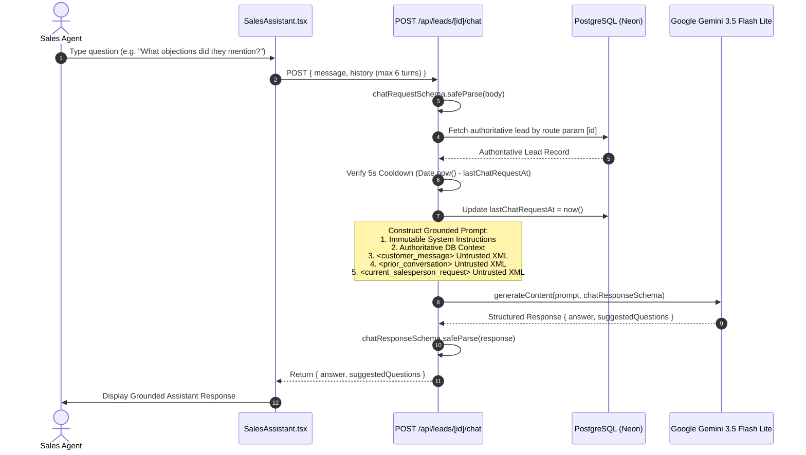
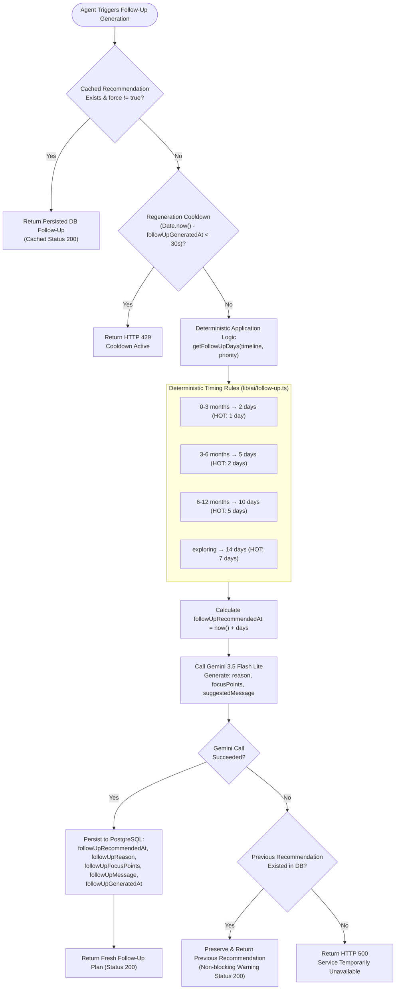
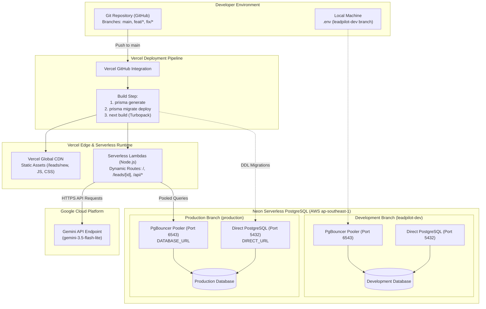

# LEADPILOT AI — SYSTEM ARCHITECTURE SPECIFICATION

This document details the verified architectural topology, component responsibilities, data flow, and deployment model of **LeadPilot AI**. 

All diagrams and specifications reflect actual source code in this repository.

---

## 1. END-TO-END APPLICATION ARCHITECTURE

The diagram below illustrates the end-to-end architecture, from the client browser interface through Next.js serverless route handlers, the deterministic scoring engine, Neon PostgreSQL persistence, and Google Gemini API integration.

---

## 2. COMPONENT RESPONSIBILITY MATRIX

| Component / File | Execution Boundary | Dependencies | Key Input / Output | Implementation State |
| :--- | :--- | :--- | :--- | :--- |
| `app/page.tsx` | Server (RSC) | `lib/db/prisma.ts`, `LeadTable.tsx` | In: HTTP Request Out: Server-rendered HTML with ranked leads | **Fully Implemented** |
| `app/leads/[id]/page.tsx` | Server (RSC) | `lib/db/prisma.ts`, `LeadAnalysisWorkspace.tsx` | In: Route `[id]` Out: Hydrated lead detail page or 404 | **Fully Implemented** |
| `components/LeadForm.tsx` | Client (`'use client'`) | `lib/validations/lead.ts`, Next Router | In: User form inputs Out: `POST /api/leads` payload, live preview | **Fully Implemented** |
| `components/LeadTable.tsx` | Client (`'use client'`) | `lib/scoring/lead-score.ts`, `types` | In: Server-hydrated leads array Out: Filtered UI tabs (`HOT`, `WARM`, `COLD`) | **Fully Implemented** |
| `components/SalesAssistant.tsx` | Client (`'use client'`) | Native `fetch`, React state | In: User text, lead context Out: Interactive chat stream & suggested questions | **Fully Implemented** |
| `components/SmartFollowUp.tsx` | Client (`'use client'`) | Native `fetch`, React state | In: Lead ID, follow-up state Out: Cadence card, reason, suggested message | **Fully Implemented** |
| `lib/scoring/lead-score.ts` | Server / Client | None (Pure TypeScript) | In: `ScoringInput` attributes Out: `ScoreResult` (Total, Priority, Breakdown) | **Fully Implemented** |
| `lib/ai/lead-analysis.ts` | Server-only | `@google/genai`, `zod`, `server-only` | In: `LeadContextForAnalysis` Out: `LeadAnalysisResult` (Zod validated) | **Fully Implemented** |
| `lib/ai/sales-assistant.ts` | Server-only | `@google/genai`, `zod`, `server-only` | In: Lead context, history, question Out: Grounded `ChatResponse` | **Fully Implemented** |
| `lib/ai/follow-up.ts` | Server-only | `@google/genai`, `zod`, `server-only` | In: Timeline, priority, lead context Out: `FollowUpAiResult`, timing days | **Fully Implemented** |
| `lib/db/prisma.ts` | Server-only | `@prisma/client`, `server-only` | In: Environment variables Out: `PrismaClient` singleton on `globalThis` | **Fully Implemented** |

---

## 3. LEAD PROCESSING & SCORING SEQUENCE

The sequence diagram below shows how an inbound lead is analyzed, scored deterministically, and persisted without allowing AI to influence the mathematical calculation.

---

## 4. GROUNDED SALES ASSISTANT INTERACTION SEQUENCE

This sequence illustrates how prompt injection defense and authoritative database context isolate the Sales Assistant from untrusted user content.

---

## 5. SMART FOLLOW-UP TIMING & CONTENT GENERATION FLOW

The flow diagram below demonstrates how deterministic business rules govern follow-up dates while Gemini provides contextual qualitative messaging.

---

## 6. PRODUCTION DEPLOYMENT TOPOLOGY (VERCEL & NEON)

The deployment diagram illustrates the separation between build-time compilation, runtime serverless execution, and multi-branch database environments.

---

## 7. ARCHITECTURAL SUMMARY

LeadPilot AI adheres to clean enterprise software engineering principles:
1. **Separation of Concerns:** Statistical LLM capabilities are strictly confined to unstructured text understanding and natural language generation. All mathematical, ranking, timing, and rate-limiting policies are enforced by deterministic TypeScript and PostgreSQL.
2. **Resilience & Fault Tolerance:** Pre-call snapshotting, bounded retries (max 2 attempts), non-mutating failure handlers, and database-persisted cooldowns protect system stability against external API interruptions.
3. **Defense in Depth:** XML boundary encapsulation, schema-enforced prompt structures, and server-side secret boundaries (`server-only`) protect against injection attacks and credential leaks.

